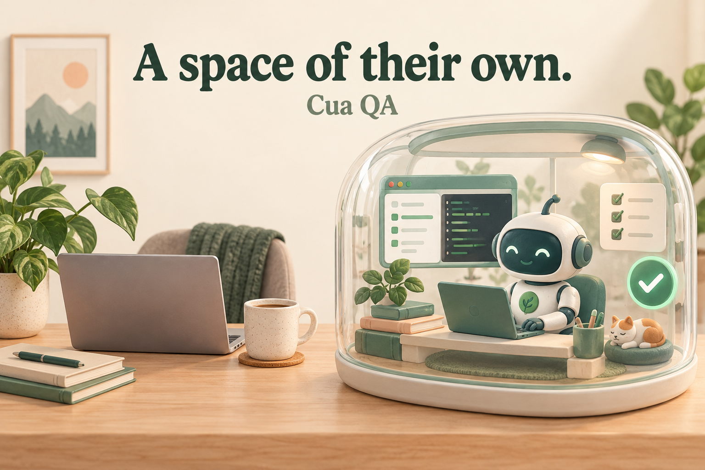

<p align="center">
  
</p>

# Cua QA

**Give your agent a test computer of its own. Keep using yours.**

One skill for repeatable application QA in a dedicated [Cua Space](https://cua.ai/docs/spaces). Your agent gets a clear place to run the app, open a browser, collect evidence and resume work without taking over your personal desktop.

## Install

```sh
npx skills add Sergio-CVM00/cua-qa
```

Choose your agent in the installer. Or target Claude Code and Codex directly:

```sh
npx skills add Sergio-CVM00/cua-qa --skill cua-qa --agent claude-code codex
```

Then ask:

> Use cua-qa to prepare a dedicated test workspace for this project and run its main user flows. Keep my personal desktop and browser untouched. Report what passed, what failed and what you could not test.

The skill guides the agent through setup. **Cua and a compatible runtime are separate prerequisites**, installed once on the machine that will run the tests. No Cua cloud account is needed for the local route. See the [first-run guide](references/setup.md).

## What your agent learns

| You want to... | The skill guides the agent to... |
| --- | --- |
| Test while you keep working | Use a dedicated guest and fresh browser profile. |
| Reproduce an environment | Record image, runtime, architecture, dependencies and build identity. |
| Test a web or desktop app | Select a compatible route and verify tools before execution. |
| Leave a longer QA session running | Establish a persistent executor, checkpoints, deadline and cleanup owner. |
| Understand a failure | Return reproduction steps, expected/actual results, screenshots and logs. |
| Resume after a disconnect | Reconcile the existing run before starting anything again. |

## Already have Cua?

After checking that the name is free, create a local Linux QA desktop:

```sh
cua sandbox create linux --on local --name qa-worker --wait desktop
cua sandbox info local:qa-worker --json
```

Then let the skill inspect and connect it. Existing dedicated QA Spaces can be reused.

For Claude Code, the documented MCP entry is:

```sh
claude mcp add cua-qa -- cua mcp --sandbox local:qa-worker --permissions sandbox:readonly,computer:all
```

[Codex TOML, other clients, CLI-only use and the smoke test](references/setup.md#3-connect-the-agent) are in the setup guide. Installing a skill does not automatically register an MCP server.

## A clear boundary

The workflow keeps QA inside the selected guest and avoids personal sessions, broad host mounts and host input devices. It checks the actual environment before calling it ready.

**This skill is not a security sandbox.** Cua's runtime supplies isolation, and its strength depends on the chosen runtime and configuration. In particular, `--sandbox` selects a default target; it does not prevent a caller from choosing another one. Stronger enforcement needs scoped service access or a dedicated runtime/account.

Default guest networking may allow outbound access. A persistent Space also needs an awake host and a running agent executor for unattended testing. The skill checks these conditions instead of promising that an open chat will run all night.

## Where it fits

| Target | Intended route | Validation in this release |
| --- | --- | --- |
| Web applications | Browser/Playwright in a Linux guest | See [validation record](docs/validation.md). |
| Linux GUI / Electron | Guest Cua computer tools | Workflow documented; app-specific validation required. |
| API / CLI | Compatible guest runtime | Workflow documented; project tests required. |
| Native macOS | Supported macOS VM/Space | Not exercised in this release. |
| Windows / Android / iOS | Compatible guest, SDK and device/emulator | Not exercised in this release. |
| Multi-hour unattended QA | Persistent executor and bounded run | Recovery guidance provided; no overnight reliability claim. |

A Linux browser test does not validate a native iOS or macOS application.

## Small package, inspectable behavior

- [SKILL.md](SKILL.md): the agent's entry point.
- [Setup](references/setup.md): prerequisites, target checks and client configuration.
- [QA workflow](references/qa-workflow.md): evidence, long runs, recovery and cleanup.
- [Environment record](assets/environment.example.json) and [result record](assets/result.example.json): reusable examples.
- [Browser smoke test](scripts/smoke.cjs): a synthetic fixture that adds a task, rejects empty input and saves evidence.

The smoke script runs only when invoked. It does not install packages or connect to your existing browser.

## Sources and license

Based on the official [Cua CLI](https://cua.ai/docs/cua-cli), [MCP](https://cua.ai/docs/cua-cli/guides/mcp-server) and [Spaces](https://cua.ai/docs/spaces/reference) documentation, reviewed on October 15, 2026. Installation uses the [Vercel skills CLI](https://skills.sh/docs/cli).

Independent community project, not an official Cua or Vercel product. MIT licensed. Cover generated with OpenAI ImageGen; [generation note](docs/cover.md).
